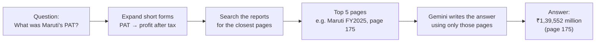
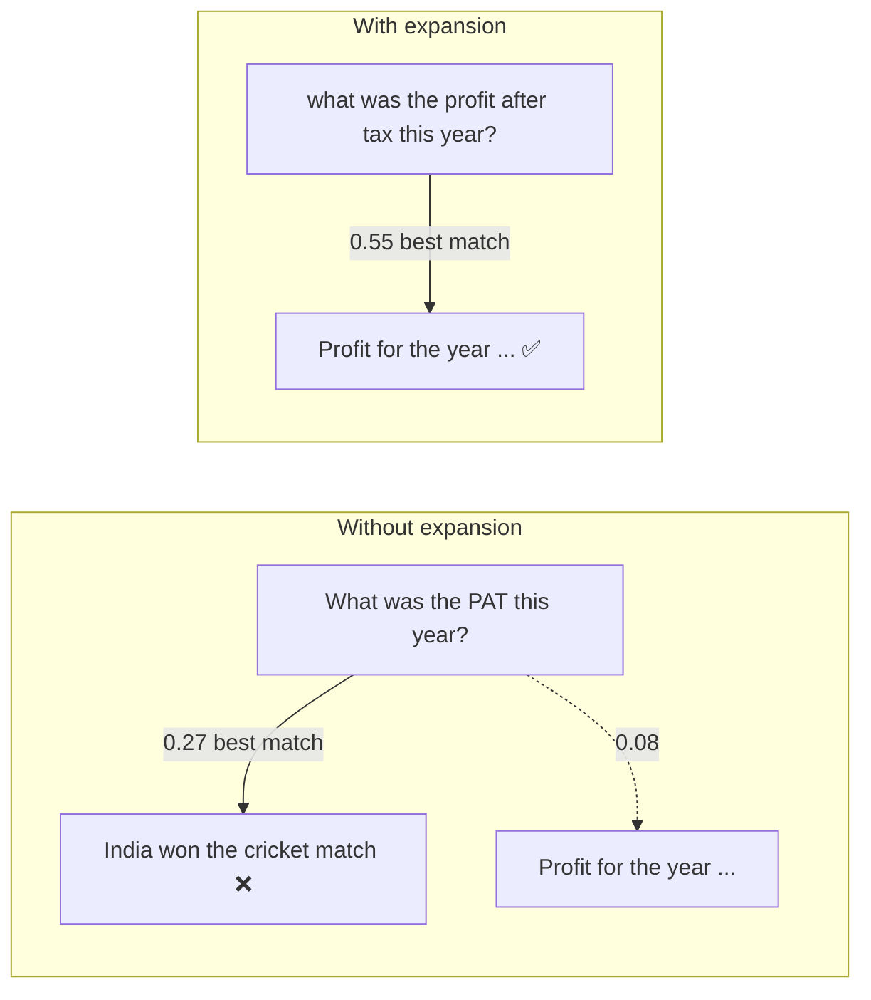
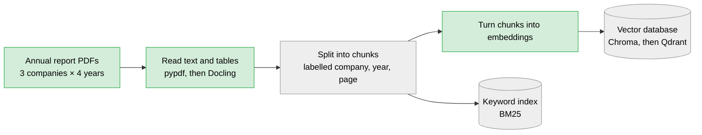
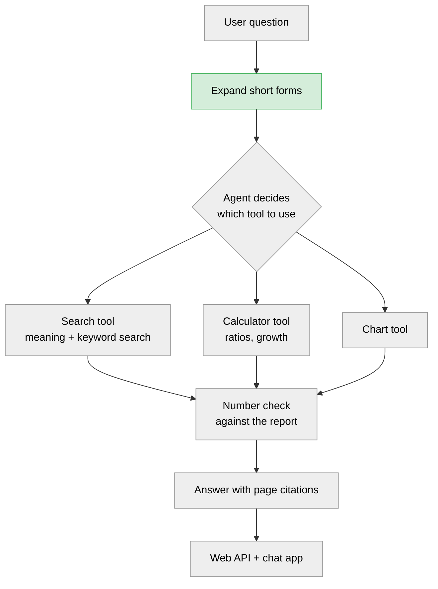
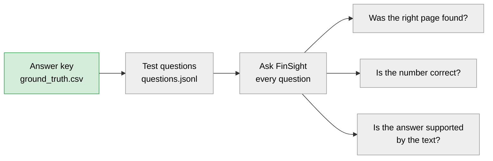

# FinSight: Annual Report Analyst

Ask questions about Indian listed companies in plain English, for example *"Compare Maruti and Mahindra profit margins for FY2023 to FY2026"*, and get an answer with:

- the **page number** it came from in the official annual report,
- numbers **calculated by code**, not guessed by the AI,
- a **measured accuracy score**, checked against a hand-made answer key.

> **Status: in progress (Week 1 of 8).** This is a learning project, built day by day from 1 November to 31 December 2026. The parts marked ✅ below work today. The rest is planned, and the empty files in `src/` are placeholders for it. See [Progress](#progress) for exactly what is done.

---

## The problem it solves

An annual report is 250 to 300 pages long. If you ask a general chatbot "What was Maruti's net profit?", it may confidently give a wrong number. FinSight works differently:

1. It **searches** the real report for the right pages.
2. It gives only those pages to the AI, which writes the answer **from them** and cites the page.
3. It **checks** answers against an answer key that was filled in by hand from the PDFs.

This approach is called **RAG** (retrieval-augmented generation): first find the right text, then let the AI answer from it.



---

## What works today ✅

| Part | File | What it does |
|---|---|---|
| First AI call | [`src/llm.py`](src/llm.py) | Sends a question to Google Gemini and prints the answer |
| Structured output | [`notebooks/01_llm_basics.ipynb`](notebooks/01_llm_basics.ipynb) | Asks Gemini for an answer in JSON format and reads it into Python |
| Reading PDFs | [`notebooks/03_pdf_loading.ipynb`](notebooks/03_pdf_loading.ipynb) | Finds the profit and loss and balance sheet pages in each report and pulls out the key lines |
| Answer key | [`eval/ground_truth.csv`](eval/ground_truth.csv) | 24 correct values for 3 companies, each with the page it came from (details below) |
| Meaning search | [`notebooks/02_embeddings.ipynb`](notebooks/02_embeddings.ipynb) | Turns sentences into embeddings, compares meanings, and expands finance short forms |
| Data sources | [`data/SOURCES.md`](data/SOURCES.md) | Where each report was downloaded from, and the traps found in each PDF |

---

## Findings so far

These come from experiments in the notebooks. Each one is a real problem found and measured.

**1. Expanding short forms beats a bigger model.**
The question *"What was the PAT this year?"* was compared with 4 report lines. With the small embedding model `all-MiniLM-L6-v2`:

| | Correct line ("Profit for the year...") | Cricket line (wrong) | Winner |
|---|---|---|---|
| Question as typed ("PAT") | 0.08 | 0.27 | ❌ cricket line |
| After expanding "PAT" to "profit after tax" | **0.55** | 0.17 | ✅ correct line |



When comparing "Net profit increased" with "PAT grew", models 5 times larger scored only 0.35 (`all-mpnet-base-v2`) and 0.63 (`BAAI/bge-base-en-v1.5`) without expansion. The small model **with** expansion scored 0.74. So a simple dictionary of short forms (`pat → profit after tax`) is applied before searching.

**2. Every company lays out its PDF differently.**
- Maruti puts two printed pages on one PDF page, so the balance sheet and the profit and loss statement share a PDF page.
- Bajaj keeps them on separate pages, and writes "Statement of Profit and Loss" without the word "Standalone".
- Searching for a statement's title also matches the auditor's report, which mentions those titles. Searching for the row labels ("Revenue from operations" plus "Profit for the year") is more reliable.

**3. Units and number formats differ.**
Maruti reports in ₹ million, while Mahindra and Bajaj report in ₹ crore (1 crore = 10 million). Mahindra writes numbers the Indian way (`1,16,483.68`). Python reads the ₹ symbol as `H` in Bajaj's PDF and as `` ` `` in Maruti's.

---

## The answer key

[`eval/ground_truth.csv`](eval/ground_truth.csv) holds values read **by hand** from the official PDFs. All values are **standalone** figures (the company alone, not including the companies it owns) for **FY2025**, which runs from 1 April 2024 to 31 March 2025.

| Company | Revenue | Net profit | Net profit margin | Debt-to-equity | Return on equity | Earnings per share |
|---|---|---|---|---|---|---|
| Maruti Suzuki | ₹15,19,001 million | ₹1,39,552 million | 9.19% | 0.00 | 14.84% | ₹443.86 |
| Mahindra & Mahindra | ₹1,16,483.68 crore | ₹11,854.96 crore | 10.18% | 0.02 | 19.25% | ₹98.80 |
| Bajaj Auto | ₹50,010.31 crore | ₹8,151.42 crore | 16.30% | 0.02 | 25.36% | ₹292.06 |

**Columns in the file:**

| Column | Meaning |
|---|---|
| `company` | Company name |
| `year` | Financial year, for example `FY2025` |
| `metric` | What the number is, for example `revenue`, `net_profit`, `roe` |
| `value` | The number itself, with no commas |
| `unit` | `million`, `crore`, `percent`, `times` or `rupees` |
| `source_page` | The PDF page the value came from, or `derived` if it was calculated from other rows |
| `screener_value` | The same value from [Screener.in](https://www.screener.in/), as a second check (not filled in yet) |

**How the ratios are calculated:**
- Net profit margin = net profit ÷ revenue × 100
- Debt-to-equity = borrowings ÷ total equity
- Return on equity = net profit ÷ total equity × 100
- Earnings per share = net profit ÷ weighted average number of shares

Later, FinSight will be asked questions about these values, and its answers will be scored against this file.

---

## How to run it

**You need:** Python 3.10 or newer, and a free Gemini API key from [Google AI Studio](https://aistudio.google.com/).

**1. Download the code and set up Python**

```bash
git clone https://github.com/Ankush-Manhas840/finsight.git
cd finsight
python -m venv .venv
.venv\Scripts\activate
pip install -r requirements.txt
```

On macOS or Linux, use `source .venv/bin/activate` instead of `.venv\Scripts\activate`.

**2. Add your API key**

Copy `.env.example` to a new file named `.env`, then replace `paste-your-key-here` with your key. The `.env` file is never uploaded to GitHub.

**3. Download the annual reports**

The PDFs are not stored in this repository because they are large (12 to 29 MB each). Download the 12 reports listed in [`data/SOURCES.md`](data/SOURCES.md) using a web browser, and save them in `data/raw/` with exactly these names:

```
data/raw/maruti_FY2023.pdf    ...    data/raw/maruti_FY2026.pdf
data/raw/mahindra_FY2023.pdf  ...    data/raw/mahindra_FY2026.pdf
data/raw/bajaj_FY2023.pdf     ...    data/raw/bajaj_FY2026.pdf
```

**4. Try it**

- Ask Gemini a question: `python -m src.llm`
- Open the notebooks: run `jupyter notebook`, then open the files in `notebooks/` in order (01, 02, 03)

The first run of `02_embeddings.ipynb` downloads a small embedding model (about 90 MB).

Coming later: building the search index, asking questions from the command line, running the accuracy tests, and the web app.

---

## Project layout

```
finsight/
├── src/                  Main code
│   ├── llm.py            ✅ Talks to Gemini
│   ├── ingest.py         Planned: split PDFs into chunks
│   ├── vectorstore.py    Planned: store and search embeddings
│   ├── rag.py            Planned: search, then answer with page citations
│   ├── agent.py          Planned: the agent that picks tools
│   ├── verify.py         Planned: check answer numbers against the report
│   ├── tools/            Planned: search, calculator and chart tools
│   └── api/              Planned: web API
├── notebooks/            Experiments, one per topic (✅ 01, 02, 03)
├── eval/                 Answer key (✅) and accuracy tests (planned)
├── data/
│   ├── SOURCES.md        ✅ Where each report came from
│   ├── raw/              The PDFs (kept on your computer only)
│   └── processed/        Generated files (kept on your computer only)
├── app/                  Planned: Streamlit chat app
├── tests/                Automatic tests
├── config/               Settings
├── LEARNINGS.md          Daily log of what broke and what worked
└── RESOURCES.md          Day-by-day study and build plan
```

---

## How it will work (full design)

Green boxes are built, grey boxes are planned.

**Step 1: prepare the reports (done once)**



**Step 2: answer a question (every time)**



**Step 3: measure accuracy**



## Tools used

| Area | Tool |
|---|---|
| Language | Python 3.10+ |
| AI model | Google Gemini (Flash models, free tier) |
| Frameworks | LangChain, LangGraph |
| Reading PDFs | pypdf now, Docling later for tables |
| Embeddings | sentence-transformers (`all-MiniLM-L6-v2` for now) |
| Vector database | Chroma first, then Qdrant |
| Keyword search | BM25 (`rank-bm25`) |
| Accuracy tests | custom scripts and RAGAS |
| Web API and app | FastAPI and Streamlit |
| Testing | pytest |
| Containers | Docker |

## Data

Annual reports of **Maruti Suzuki, Mahindra & Mahindra and Bajaj Auto**:
- ✅ FY2025: downloaded from the NSE archive and Bajaj's investor website (see [`data/SOURCES.md`](data/SOURCES.md))
- ✅ FY2023, FY2024 and FY2026: downloaded from the NSE archive (FY2026 is the latest, published June to August 2026)

---

## Accuracy results

This table will be filled in as each version is built and tested.

| Version | Change | Right page found in top 5 | Numbers correct | Answer supported by the text |
|---|---|---|---|---|
| v1 | Basic search (pypdf + Chroma) | | | |
| v2 | Better table reading (Docling) | | | |
| v3 | Filters + keyword search + reranking | | | |
| v4 | Agent + calculator + number check | | | |

---

## Progress

The study material for each day is in [RESOURCES.md](RESOURCES.md).

### Week 1: AI and finance basics
- [x] **Nov 1:** First Gemini call (`src/llm.py`)
- [x] **Nov 2:** Structured JSON output (`notebooks/01_llm_basics.ipynb`)
- [x] **Nov 3:** Downloaded FY2025 reports (`data/SOURCES.md`)
- [x] **Nov 4:** Answer key: revenue, profit, equity and borrowings for 3 companies
- [x] **Nov 5:** Ratios added to the answer key (*finance glossary in LEARNINGS.md still to write*)
- [x] **Nov 6:** Embeddings notebook and short-form expansion
- [x] **Nov 7:** FY2023, FY2024 and FY2026 reports downloaded (12 PDFs in total). *Buffer day*

### Week 2: LangChain and the first RAG
- [ ] **Nov 8:** LangChain chat model
- [x] **Nov 9:** PDF loading notebook (*done early with pypdf; LangChain loader still to try*)
- [ ] **Nov 10:** Chunking with labels
- [ ] **Nov 11:** Chroma vector database
- [ ] **Nov 12:** RAG with page citations
- [ ] **Nov 13:** Command-line questions and first failure log
- [ ] **Nov 14:** *Buffer*

### Week 3: Measuring accuracy
- [ ] **Nov 15:** 30 test questions
- [ ] **Nov 16:** Was the right page found?
- [ ] **Nov 17:** Are the numbers correct?
- [ ] **Nov 18:** RAGAS faithfulness score
- [ ] **Nov 19:** First results (v1)
- [ ] **Nov 20:** 50 test questions
- [ ] **Nov 21:** *Buffer*

### Week 4: Better search
- [ ] **Nov 22:** Read tables with Docling
- [ ] **Nov 23:** Table-aware chunks (v2)
- [ ] **Nov 24:** Filter by company and year
- [ ] **Nov 25:** Meaning search plus keyword search together
- [ ] **Nov 26:** Reranker
- [ ] **Nov 27:** Chunk headers with context (v3)
- [ ] **Nov 28:** *Buffer*

### Week 5: Qdrant and the agent
- [ ] **Nov 29:** Move to Qdrant
- [ ] **Nov 30:** Practice agent
- [ ] **Dec 1:** Search tool
- [ ] **Dec 2:** Calculator tool and tests
- [ ] **Dec 3:** LangGraph agent
- [ ] **Dec 4:** Comparing several companies
- [ ] **Dec 5:** *Buffer*

### Week 6: An agent you can trust
- [ ] **Dec 6:** Chart tool
- [ ] **Dec 7:** Number checking
- [ ] **Dec 8:** Guardrails: refuse off-topic questions and say "not found" instead of guessing, plus tests
- [ ] **Dec 9:** Agent test questions
- [ ] **Dec 10:** Results (v4)
- [ ] **Dec 11:** Monitoring: log every question, its pages, cost and speed
- [ ] **Dec 12:** Cache and router: repeat questions are free, easy ones go to the cheaper model

### Week 7: Release
- [ ] **Dec 13:** FastAPI `/ask` endpoint
- [ ] **Dec 14:** API tests
- [ ] **Dec 15:** Streamlit chat app
- [ ] **Dec 16:** Upload your own report, safe from hidden instructions inside the PDF
- [ ] **Dec 17:** Docker
- [ ] **Dec 18:** Free online demo, with a limit on questions per minute
- [ ] **Dec 19:** *Buffer*

### Week 8: Showcase
- [ ] **Dec 20:** Two more companies
- [ ] **Dec 21:** Final diagram and results
- [ ] **Dec 22:** Cleanup
- [ ] **Dec 23:** Blog post
- [ ] **Dec 24:** Demo video
- [ ] **Dec 26:** LinkedIn post and resume
- [ ] **Dec 27–31:** Practice interviews about this project

## Ideas for later

- Suggest the full form while the user types a short form (for the chat app)
- Connect with the fraud-detection-realtime project, so the agent explains flagged transactions
- Offer the tools as an MCP server
- A small fine-tuned model for pulling numbers out of reports
